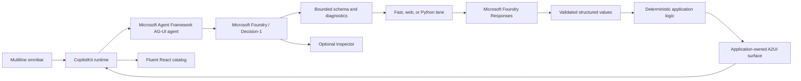

# Decision-1 A2UI Implementation Plan

## Product outcome

Turn a short natural-language command into one bounded, trusted, interactive
object. Microsoft Decision-1 selects the UI schema, Microsoft Foundry extracts or researches the
data, deterministic application code owns calculations and actions, and AG-UI
streams versioned A2UI operations to the CopilotKit renderer.

The application never asks a model to generate React, HTML, CSS, JavaScript, or
callbacks.

## Current architecture



### Runtime invariants

- The frontend uses `agent.isRunning` as the authoritative AG-UI run state.
- Each progressive A2UI snapshot keeps one stable surface ID and uses a unique
  tool-call ID.
- Superseded client runs are generation-guarded. An older aborted run cannot
  end or overwrite the current run.
- Every model payload is validated before rendering.
- Calculable results and interactive actions are application-owned.
- The page remains fixed while generated card content scrolls internally.
- The Inspector reflows wide layouts and becomes a drawer on narrow layouts.

## Completed

- Direct Entra-authenticated Microsoft Decision-1 classification with closed schema selection,
  probabilities, signals, confidence, and margin diagnostics.
- Microsoft Foundry Responses integration using Entra authentication.
- Microsoft Agent Framework AG-UI endpoint and CopilotKit multi-route bridge.
- A2UI v0.9 application-owned catalog and generic fallback surface.
- Progressive sourced Answer streaming with citations.
- Production Graph extraction and rendering across 18 chart kinds, including
  point callouts, keyboard-accessible series filtering, and direct line isolation.
- Stable responsive chart hosts that avoid Fluent measurement feedback loops.
- Purpose-built Convert instrument with editable values, unit dropdowns, swap,
  and deterministic recomputation.
- Purpose-built Split card with deterministic arithmetic, per-person answer,
  bill-versus-tip visual, and responsive facts.
- Purpose-built Calc, Countdown, and Timer cards for deterministic arithmetic,
  derived date context, and a trusted local clock lifecycle.
- Purpose-built Expense card with normalized currency, amount-first hierarchy,
  and concise merchant, category, and date facts.
- Purpose-built Checklist card with local Fluent controls to add, rename,
  remove, and complete tasks, plus synchronized progress, initial done state,
  and optional due-date evidence.
- Purpose-built Weather card with provider-owned current and forecast readings,
  deterministic units, precipitation and wind context, temperature range, and
  a responsive daily outlook.
- Three-line auto-growing omnibar, visible run phases, timeout recovery,
  reliable Escape clearing, local Keep action, and responsive Inspector.
- Backend contract, extraction, surface, and agent regression coverage.

## Current phase: finish the native card catalog

The generic fallback proves every schema can render. The next phase promotes
each high-value schema into an application-owned component using the approved
visual grammar.

### Recommended order

1. **Provider-backed readings**
   - Bookmark
   - Color
2. **Editable task objects**
   - Event
   - Reminder
   - Shopping
   - Habit
   - Note
   - Goal
   - Contact
   - Trip
3. **Interactive tools**
   - Poll
   - Random
   - Password

Each promotion must include:

- a purpose-built surface builder;
- deterministic derivation for computable values;
- the approved Fluent/A2UI component composition;
- loading, error, empty, long-content, keyboard, and narrow-layout behavior;
- contract and surface regression tests;
- live desktop and narrow-browser verification.

## Next implementation slice

Promote **Bookmark** from the generic fallback into a provider-backed reading:

- normalize and validate the supplied URL;
- show the resource title and destination as the dominant reading;
- preserve tags and any safely retrieved public metadata;
- keep opening or saving the bookmark behind an explicit user action;
- add backend surface tests and desktop/narrow live verification.

## Quality gates

Before completing each slice:

```powershell
uv --directory backend run pytest -q
uv --directory backend run ruff check .
npm --prefix frontend run lint
frontend\node_modules\.bin\tsc.cmd --noEmit
npm --prefix frontend run build
git --no-pager diff --check
```

For visual slices, run one bounded desktop/mobile Edge pass, inspect console
errors and layout shift, fix the observed defect batch, and run at most one
confirmation pass.

## Deferred

- Real calendar, reminder, contact, expense, bookmark, or travel side effects.
- Arbitrary generated UI or executable model output.
- Silent provider failover.
- Re-benchmark classification and capability dispatch against Decision-1. The
  existing JEV measurements remain only as a historical baseline.

## Definition of prototype completion

- Every schema has a native application-owned experience or an explicitly
  accepted generic fallback.
- No stale run can overwrite or terminate a newer request.
- No invalid payload is rendered.
- Keyboard, narrow-layout, reduced-motion, loading, timeout, and error states
  work across the catalog.
- The unchanged evaluation corpus records classification accuracy, acceptable
  ambiguity, latency, cancellation correctness, payload validity, and provider
  failures.
- Setup, architecture, extension guidance, and known limits are current.
